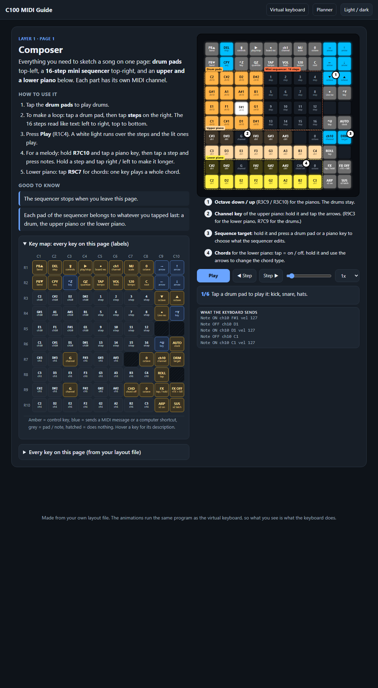
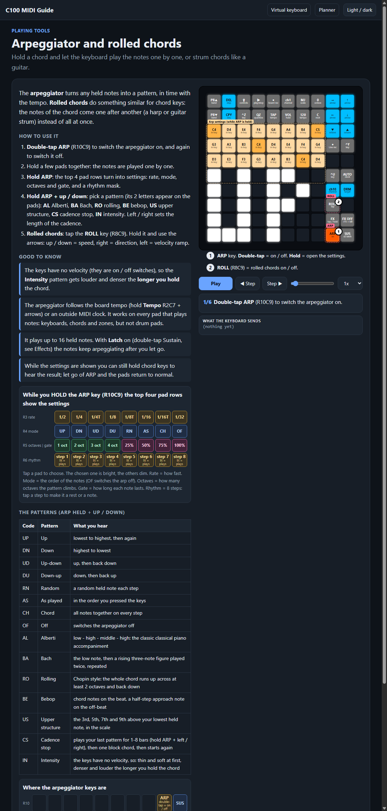

# C100 MIDI Studio

### Turn a 100-key Keychron C100 8K into a multi-layer MIDI instrument.

A giant macro pad becomes a drum machine, a chord keyboard, a clip launcher, a Euclidean rhythm box, a CC sequencer and a generative music toy. All on one board, with no software on your computer. Plug it in and it shows up as a MIDI device.

> ## ⚠️ Tested on Windows only
> The flashing and build tools in this project (`.bat` files) were written and tested on **Windows 11**. They have **not** been tried on macOS or Linux. The browser tools (guide, virtual keyboard, planner, keycap designer) are plain web pages and should work anywhere.



---

## What you get

**4 layers, 19 pages, 100 keys.** Hold **Shift** and tap the four arrow keys to move between layers and pages. Shift does nothing else.

| Layer | Colour | What it is |
|---|---|---|
| **1. Keyboards** | amber | Composer (drum pads + 16-step mini sequencer + two pianos), chromatic grid, in-key grid, chord keyboard, harmony keyboard, multi-channel, **microtonal** (MPE) |
| **2. Ableton control** | blue | Clip launcher, XY effect pads, macro faders, 32 knobs, Ableton shortcuts |
| **3. Sequencers** | green | 4-track step recorder, drum sequencer, **Euclidean rhythms**, **CC sequencer** (4 lanes, 8 effect layers, MIDI learn) |
| **4. Generative** *(experimental)* | own colours | **Random walk**, **Pond** (ripples that play notes), **Constellation** |

On every page, a shared set of tools:

- **Arpeggiator** with 15 patterns (up, down, random, Alberti, Bach, Chopin-style rolling, bebop, cadence stop, a pattern that builds with how long you hold ...)
- **Rolled chords**: strum any chord like a harp or a guitar
- **12 MIDI effects**: delay, ping-pong, reverse delay, chorus, harmonizer, ratchet, note repeat, strum, flam, tremolo, vibrato, humanize
- **Hold a key, then tap the arrows** to set scale, root, tempo, octave and channel, with no menus and no screen
- **MIDI clock in**: follows Ableton's clock, or runs on its own
- **Sustain and latch**, scales from 12-tone to non-Western, and per-page MIDI channels

## It comes with its own tools

Everything runs in a web browser from a single file. No install.

| Tool | What it does |
|---|---|
| **[The guide](files/keymap-v13/C100_guide.html)** | Every page explained, with a **labelled map of all 100 keys** (the keyboard has no printed legends) and an **animation you can play and step through**. The animations run the real engine, so they are not recordings. |
| **[Virtual keyboard](files/keymap-v13/C100_virtual_keyboard.html)** | The whole board in your browser, sending real MIDI. Test every change before you flash. |
| **[Planner](files/keymap-v13/C100_keymap_planner.html)** | Click a key, choose its job, export the layout. |
| **[Keycap designer](files/keymap-v13/C100_keycap_designer.html)** | Design printed keycap legends, up to 4 sections per key, colour-coded to match the LEDs. |
| **[Keycap layout (SVG)](files/keymap-v13/C100_keycaps_layout.svg)** | The whole keyboard at real size, ready for a keycap shop. |



## Videos

A 12-episode draft series is in **[`videos/`](videos/)**: animated, with a computer voice, made straight from the guide's engine (the scripts are in `video scripts/`). Scenes that need real footage are marked "footage to add". `video tools/` has the generator (`make_episode.js`, needs Node.js, Edge and ffmpeg).

## Quick start

1. **Flash it.** Unplug the keyboard, hold the **top-left key**, plug it in, let go after 3 seconds. Double-click **`Flash C100.bat`** and pick `keychron_c100_8k_midi_v13.bin`.
2. **Tell your music program.** In Ableton: Preferences > Link / Tempo / MIDI, switch **Track** (and **Remote**) *On* for "Keychron C100 8K". Set a MIDI track's *MIDI From* to the keyboard and arm it.
3. **Open the guide** and start with the first layer.

Full instructions, the Windows driver step and what every tool does: **[START HERE - README](START%20HERE%20-%20README.md)**.

**Want to change the firmware?** Follow **[BUILDING.md](BUILDING.md)**: installing QMK MSYS, Git, Node.js and gcc, downloading the Keychron QMK source, and using your own folders (`build-locations.txt`). `Set up building.bat` does the checking and the download for you.

> **Safety:** only flash a **C100 8K**. After flashing, the keyboard stops typing and becomes a MIDI device. Flash `c100_8k_STOCK.bin` to go back. If it ever does not start, the tiny **RESET** button inside the keyboard always brings it back. Flash mode lives in the chip and cannot be overwritten.

## How it is built (for the curious)

One text file, **`c100-layout-v13.txt`**, says what every key does on every page. Everything else is made from it:

```
 layout file ──► planner  (edit it)
      │
      ├────────► guide, virtual keyboard, keycaps   (generated)
      │
      └────────► keymap.c ──► QMK ──► firmware .bin
```

The behaviour exists twice: once in JavaScript (`engine.js`, the simulator behind the guide and the virtual keyboard) and once in C (the firmware). **A test runs both side by side** with about 70 scenarios, including random key-mashing, and checks that they send exactly the same MIDI bytes. If they ever differ, the build is not trusted.

The firmware is built on [QMK](https://qmk.fm) and the Keychron QMK fork for the AT32F405 chip (256 KB flash).

## Roadmap

- More Walker and Pond live controls
- Two-board build (two C100s side by side, one MIDI channel and note range each)
- Video series: the scripts are in `video scripts/`, and there is a pipeline for animated drafts with a computer voice

## Credits and licence

This project started from the idea and the first firmware by **[FingerDrum Labo](https://github.com/FingerDrumLabo/keychron-c100-midi)**, who showed that the C100 8K can be a MIDI controller. It is built on **QMK** and **Keychron's** open firmware. All are GPL, so this project is released under the **GNU GPL v2** (see [LICENSE](LICENSE)).

**No warranty.** This is a hobby project, provided "as is" (GPL v2, sections 11 and 12). Flashing any firmware carries a risk. You do it at your own risk; the RESET button and `c100_8k_STOCK.bin` are the way back. Only flash a C100 8K.

Not affiliated with, endorsed by, or sponsored by Keychron, Ableton, Apple or Microsoft. Product names are used only to say what this works with. All trademarks belong to their owners.
